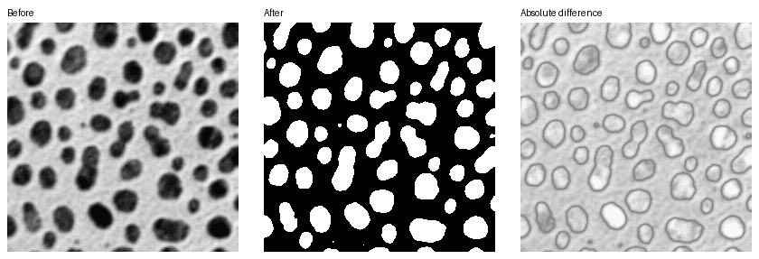

# Fiji MCP Server

[](https://github.com/surajinacademia/Fiji_imageJ_mcp/actions/workflows/ci.yml)
[](https://pypi.org/project/fiji-mcp-server/)
[](https://github.com/surajinacademia/Fiji_imageJ_mcp/blob/main/LICENSE)

An MCP server that lets an AI assistant work in [Fiji/ImageJ](https://fiji.sc/): open and save images, find and run installed commands and plugins, run ImageJ macros or Groovy, read the Results table, and check its work with screenshots.



*A recorded run on the ImageJ blobs sample: the assistant opened the image, thresholded it with a macro, counted 43 particles, and compared before and after screenshots.*

## Tools

| Tool | What it does |
| --- | --- |
| `get_state` | Reports whether Fiji is running, which images are open, and the Results table size. |
| `search_commands` | Searches Fiji's installed commands and plugins and shows how each can be called. |
| `run_command` | Runs one installed command with its parameters. |
| `run_script` | Runs an ImageJ macro (IJM) or a Groovy script. |
| `open_image` | Opens a local image and makes it the active one. |
| `save_image` | Saves the active image to a new file. |
| `get_results` | Reads the Results table, a page at a time. |
| `screenshot` | Returns a PNG of the active image or the Results table. |
| `compare_screenshots` | Compares two saved screenshots, by eye and by pixel values. |

The [tool reference](https://github.com/surajinacademia/Fiji_imageJ_mcp/blob/main/docs/tools.md) lists every argument, return field, and limit.

## Install

Needs Python 3.10 or newer and a local [Fiji](https://fiji.sc/) installation.

```bash
python -m pip install fiji-mcp-server
```

Every client below needs two settings: `FIJI_PATH`, the Fiji folder that contains `jars/` and `plugins/` (for example `/Applications/Fiji`), and `FIJI_MODE=headless`. Fiji starts on the first tool call, which can take a minute.

## Connect

**Claude Code**

```bash
claude mcp add fiji -e FIJI_PATH=/Applications/Fiji -e FIJI_MODE=headless -- fiji-mcp-server
```

**Codex**

```bash
codex mcp add fiji --env FIJI_PATH=/Applications/Fiji --env FIJI_MODE=headless -- fiji-mcp-server
```

Then set `startup_timeout_sec = 120` and `tool_timeout_sec = 300` under `[mcp_servers.fiji]` in `~/.codex/config.toml`, so Codex waits for Fiji to start and for long operations.

**Claude Desktop, Cursor, Gemini CLI, and Antigravity** use the same entry:

```json
{
  "mcpServers": {
    "fiji": {
      "command": "fiji-mcp-server",
      "env": { "FIJI_PATH": "/Applications/Fiji", "FIJI_MODE": "headless" }
    }
  }
}
```

| Client | Where the entry goes |
| --- | --- |
| Claude Desktop | `~/Library/Application Support/Claude/claude_desktop_config.json` (macOS) or `%APPDATA%\Claude\claude_desktop_config.json` (Windows), then restart the app |
| Cursor | `~/.cursor/mcp.json`, or `.cursor/mcp.json` in a project |
| Gemini CLI | `~/.gemini/settings.json`, or `.gemini/settings.json` in a project |
| Antigravity | Agent panel `…` menu → MCP Servers → Manage MCP Servers → View raw config |

If a client cannot find `fiji-mcp-server`, use the full path that `which fiji-mcp-server` prints (`where` on Windows).

## Use

> Open `/data/cells.tif`, threshold it with Otsu, measure the particles, and show me the Results table and a before-and-after screenshot.

> Search the installed commands for "Gaussian Blur" and run it with sigma 2.

## Evaluation

The figure above comes from a scripted run of the server on ImageJ's blobs sample: open the image, threshold it with Otsu, measure particles of at least 50 pixels that do not touch the edge, and compare before and after screenshots. Fiji found 43 particles, from 81 to 902 px². An independent count of the saved mask, written without Fiji, finds the same 43 particles with identical areas.

```bash
FIJI_PATH=/Applications/Fiji python examples/blobs/run_blobs.py --output my-run
python examples/blobs/check_blobs.py my-run
```

The recorded run is in [examples/blobs/run](https://github.com/surajinacademia/Fiji_imageJ_mcp/tree/main/examples/blobs/run): every tool call in order, Fiji's Results table, and the check. CI runs the unit and MCP contract tests on Python 3.10–3.12 for every push.

## Limits

- `run_script` runs any macro or Groovy code with your permissions. Use the server only with a client you trust on your own computer.
- Headless mode cannot answer dialogs. Plugins that need a dialog, mouse, or keyboard may fail; set `FIJI_MODE=gui` only when you want Fiji's window.
- An operation that runs longer than `FIJI_OPERATION_TIMEOUT_SEC` (default 240 s) stops the server, because Java work cannot be cancelled safely. Restart the client's connection, and keep the client's tool timeout above this value.
- `save_image` will not overwrite an existing file; `screenshot` and `compare_screenshots` will, so give them new paths when you want to keep old ones.

## Development

```bash
python -m pip install -e ".[test,dev]"
python -m pytest -m "not integration"
```

The integration tests need a local Fiji; see `tests/test_integration_runtime.py`. The [changelog](https://github.com/surajinacademia/Fiji_imageJ_mcp/blob/main/CHANGELOG.md) lists each release.

## Credits and license

Built on [Fiji](https://fiji.sc/), [ImageJ](https://imagej.net/), [PyImageJ](https://github.com/imagej/pyimagej), and [FastMCP](https://gofastmcp.com/). [napari-mcp](https://github.com/royerlab/napari-mcp) inspired the design. The example image is ImageJ's blobs sample.

The code is BSD-3-Clause; see [LICENSE](https://github.com/surajinacademia/Fiji_imageJ_mcp/blob/main/LICENSE). Image credits and terms are in [THIRD_PARTY_NOTICES.md](https://github.com/surajinacademia/Fiji_imageJ_mcp/blob/main/THIRD_PARTY_NOTICES.md).
